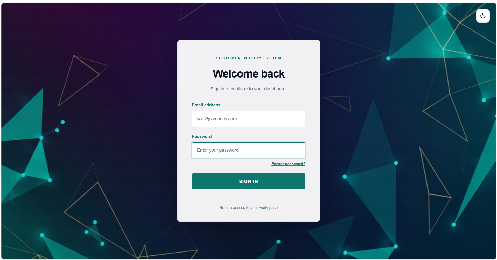
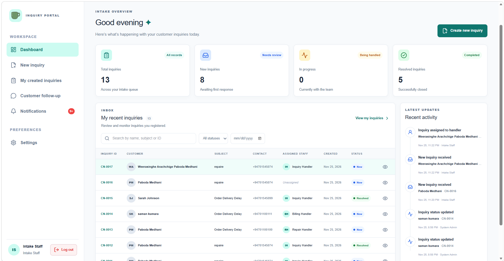
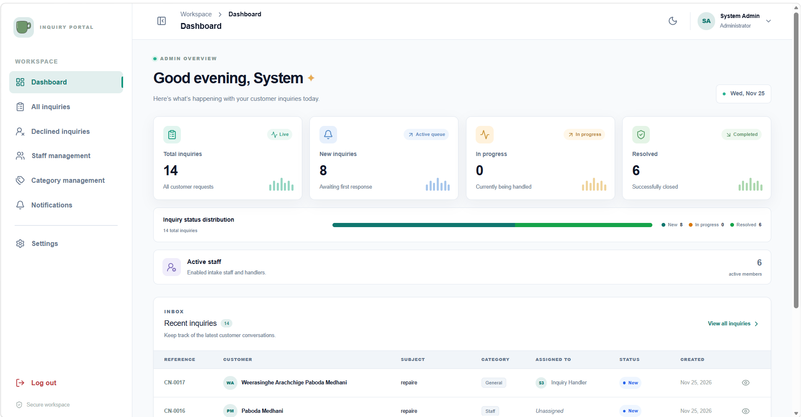
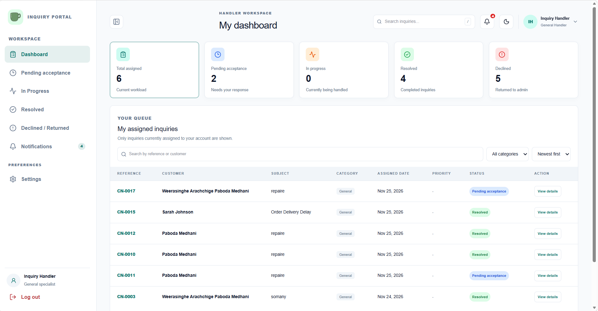

# Customer Inquiry System

A role based customer inquiry portal for registering customer requests, routing work to the right handler, and tracking each inquiry through resolution.

The repository contains a **Next.js frontend** and an **Express/PostgreSQL API**. Staff sign in through the same portal and see features for their role.

## Features

- **Intake staff** can create inquiries, attach evidence, and track inquiries they submitted.
- **Handlers** can review work assigned to them, accept or decline an assignment, and resolve accepted work.
- **Admins** can manage staff and inquiry categories, review inquiries, and reassign unassigned or declined work.
- Automatic assignment selects an active handler for the inquiry category with the lowest active workload. Ties rotate between handlers.
- Inquiry history and notifications record important workflow updates.
- Sessions are stored in PostgreSQL. Passwords are hashed with bcrypt.
- Inquiry lists support search, filters, and pagination.

## Screenshots

### Sign-in



### Intake dashboard



### Admin dashboard



### Handler dashboard



## Technology

| Area | Tools |
| --- | --- |
| Frontend | Next.js 16, React 19, TypeScript, Tailwind CSS 4 |
| Backend | Node.js, Express 5 |
| Database | PostgreSQL (`pg`) |
| Authentication | Express sessions, PostgreSQL session store, bcrypt |
| Tests | Node.js built-in test runner |

## Repository layout

```text
backend/
  src/controllers/       API request handlers
  src/db/migrations/     Database schema setup
  src/middleware/        Authentication and role checks
  src/routes/            API route definitions
  src/services/          Assignment and access-control logic
  test/                  Backend tests
frontend/
  src/app/                Login and role-based pages
  src/components/         Shared UI components
  src/lib/                API and client-side helpers
```

## Requirements

- Node.js 20.9 or newer, with npm
- PostgreSQL (local installation or a reachable PostgreSQL server)
- Git, or a downloaded copy of this repository

### Database setup note

The project has one SQL schema file: `backend/src/db/migrations/000_baseline_schema.sql`. The migration command creates the application tables automatically. You only need to create an empty PostgreSQL database first; do not paste the SQL into pgAdmin separately.

## Local setup

Get a copy of the repository, install PostgreSQL and Node.js, then follow these steps. Keep the backend and frontend running in separate terminals.

### 1. Create an empty PostgreSQL database

In pgAdmin, connect to your PostgreSQL server, right-click **Databases**, choose **Create > Database**, and name it `customer_inquiry_system`. Leave it empty. You can use another database name, but use the same name in the `.env` file below.

### 2. Configure and start the backend

In the `backend/` folder, create a file named `.env` (not `.env.txt`) and put in your PostgreSQL connection details. Replace `your_local_database_password` with the password for your PostgreSQL user. Set `SESSION_SECRET` to a long, random value.

```dotenv
DB_HOST=localhost
DB_PORT=5432
DB_NAME=customer_inquiry_system
DB_USER=postgres
DB_PASSWORD=your_local_database_password
SESSION_SECRET=replace_with_a_long_random_secret
PORT=5000
NODE_ENV=development
```

Open a terminal at the repository root and run:

```bash
cd backend
npm ci
npm run db:migrate
npm run dev
```

`npm run db:migrate` creates all application tables from the single SQL file. It records completed migrations, so it skips a migration that has already been applied. The API listens on `http://localhost:5000`; check it at [http://localhost:5000/api/health](http://localhost:5000/api/health). Keep this terminal open.

### 3. Add local demo accounts

The application does not have a public sign-up page. For a local demo, open a second terminal at the repository root and run this after the migration succeeds:

```bash
cd backend
node src/seed/seedUsers.js
```

The script inserts sample staff accounts and does not overwrite accounts with matching emails. If you already have accounts in the database, you can skip this step. These fixed demo passwords are for local development only; do not expose the app with these accounts enabled.

| Role | Email | Demo password |
| --- | --- | --- |
| Admin | `admin@example.com` | `Admin@123` |
| Intake | `intake@example.com` | `Intake@123` |
| General handler | `handler@example.com` | `Handler@123` |
| Technical handler | `technical@example.com` | `Technical@123` |
| Repair handler | `repair@example.com` | `Repair@123` |
| Billing handler | `billing@example.com` | `Billing@123` |

### 4. Configure and start the frontend

The frontend defaults to the local API URL, so no frontend environment file is needed for a standard local setup. If your API runs at a different address, create `frontend/.env.local`:

```dotenv
NEXT_PUBLIC_API_URL=http://localhost:5000
```

In a third terminal, run:

```bash
cd frontend
npm ci
npm run dev
```

Open [http://localhost:3000](http://localhost:3000) and sign in with one of the demo accounts above, or with an account already in your database.

## Environment variables

| Variable | Used by | Required | Purpose |
| --- | --- | --- | --- |
| `DB_HOST` | Backend | Yes | PostgreSQL hostname |
| `DB_PORT` | Backend | Yes | PostgreSQL port |
| `DB_NAME` | Backend | Yes | Database name |
| `DB_USER` | Backend | Yes | Database user |
| `DB_PASSWORD` | Backend | Yes | Database password |
| `SESSION_SECRET` | Backend | Yes | Secret used to sign session cookies |
| `PORT` | Backend | No | API port; defaults to `5000` |
| `NODE_ENV` | Backend | No | Set to `production` to mark the session cookie secure |
| `NEXT_PUBLIC_API_URL` | Frontend | No | API base URL; defaults to `http://localhost:5000` |

## Troubleshooting

- **Database connection refused:** Make sure PostgreSQL is running and `DB_HOST` and `DB_PORT` point to it.
- **Password authentication failed:** Check `DB_USER` and `DB_PASSWORD` in `backend/.env`.
- **Database does not exist:** Create the empty database in pgAdmin and make sure its name matches `DB_NAME`.
- **Login fails after setup:** Run the demo-account seed command above, or use an account that already exists in the database.
- **Port already in use:** Stop the other process using port `5000` (API) or `3000` (frontend), then start the project again.

## Role workflows

### Intake staff

1. Create an inquiry with customer details, category, description, and optional evidence.
2. The API checks for an active duplicate and attempts automatic assignment.
3. Track the inquiry, review its history, and receive status notifications.

### Handler

1. Review inquiries assigned to your account.
2. Accept a pending inquiry to move it into progress, or decline it with a reason so an admin can reassign it.
3. Resolve an accepted inquiry when the work is complete.

### Admin

1. Manage intake staff, handlers, and categories.
2. Review all inquiries and their history.
3. Reassign unassigned or declined inquiries to an active handler with the matching specialization.

## API overview

All application routes are under `/api`. Inquiry and admin endpoints require an authenticated session; admin management endpoints require the `ADMIN` role, and handler workflow endpoints require the `HANDLER` role. Inquiry access is also checked against the user's role and relationship to each inquiry.

| Route | Purpose |
| --- | --- |
| `GET /api/health` | API health check |
| `POST /api/auth/login` | Sign in |
| `GET /api/auth/me` | Get the current user |
| `POST /api/auth/logout` | Sign out |
| `GET /api/inquiries` | List inquiries visible to the current role |
| `POST /api/inquiries` | Create an inquiry (intake staff) |
| `GET /api/inquiries/:id` | View inquiry details and evidence if authorized |
| `GET /api/inquiries/:id/history` | View inquiry history if authorized |
| `POST /api/inquiries/:id/accept` | Accept a handler assignment |
| `POST /api/inquiries/:id/decline` | Return a pending assignment with a reason |
| `POST /api/inquiries/:id/resolve` | Resolve an accepted inquiry |
| `/api/admin/*` | Admin staff, category, and reassignment management |
| `/api/notifications/*` | Read notifications for the signed-in user |

## Development commands

### Backend

```bash
cd backend
npm run dev       # Start API with nodemon
npm start         # Start API normally
npm test          # Run backend tests
npm run db:migrate # Create the database schema (first setup)
```

### Frontend

```bash
cd frontend
npm run dev       # Start local Next.js server
npm test          # Run frontend state tests
npm run lint      # Run ESLint
npm run build     # Create a production build
npm start         # Serve the production build
```

## Security and deployment notes

- Use a unique, long `SESSION_SECRET` and strong database credentials outside local development.
- Do not use the bundled demo accounts in a shared or production environment.
- The backend currently allows browser requests from `http://localhost:3000` in its CORS configuration. Update `backend/src/app.js` for the deployed frontend origin before hosting the apps separately.
- In production, serve over HTTPS so the session cookie can use the `secure` flag.
- Evidence is sent as base64 JSON and stored in PostgreSQL. Keep uploads within the configured file type and size limits.
- Never commit `.env`, `.env.local`, or real credentials.

## Tests

Backend tests use mocked database calls and Node's built-in test runner. They cover automatic assignment, intake access restrictions, handler workflow actions, and selected authorization checks. They do not replace testing against a configured PostgreSQL database or a live browser session.
